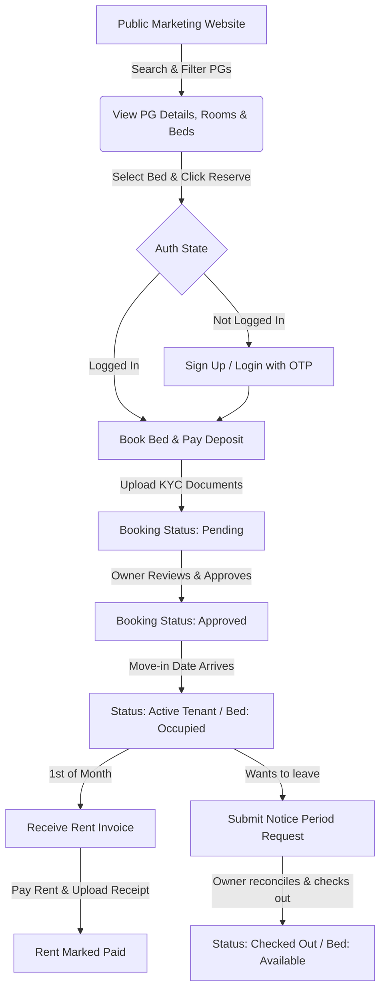
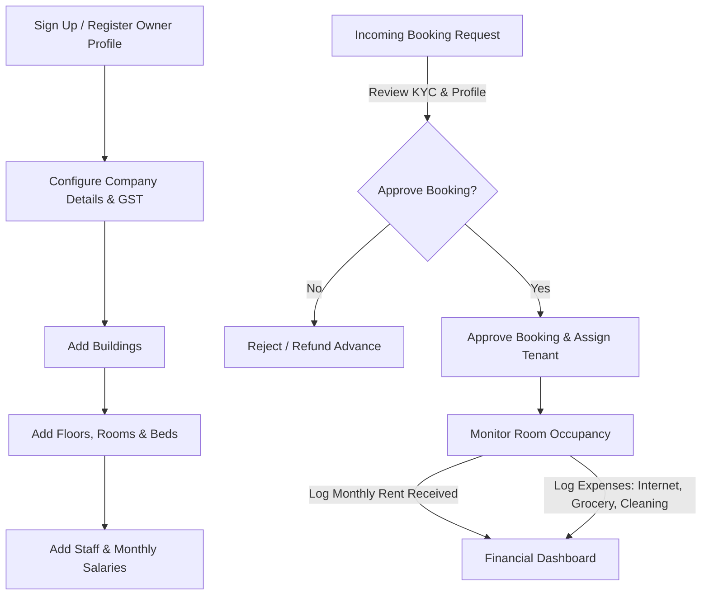

# HomiePG - User Flows & Journeys

This document models the primary pathways for both Tenants and PG Owners through the HomiePG ecosystem.

---

## 1. Tenant User Journey

### 1.1. Detailed Steps (Tenant)
1. **Search & Select**: Tenant visits the portal, filters by City, Gender Type (Boys/Girls/Unisex), budget, and room criteria (AC, Attached Bathroom).
2. **Reservation**: Sees a visual room/bed layout. Selects an "Available" bed, fills out profile data, pays the security deposit/booking advance.
3. **KYC Submission**: Uploads ID proofs (Aadhaar/PAN).
4. **Residency**: Once approved, tenant checks in. Receives automated mobile/in-app notifications for rent invoices, logs complaints, views roommate list.
5. **Check-out**: Submits expected leave date. Once cleared, system logs the checkout, updates bed history, and processes deposit return.

---

## 2. PG Owner User Journey

### 2.1. Detailed Steps (Owner)
1. **Onboarding**: Owner registers, enters company details, PAN/GST numbers for verified billing.
2. **Setup Property**: Configures building profile, maps, layouts. Adds rooms, sets prices, and specifies individual beds. Maps amenities.
3. **Tenant Approval**: Receives notification of booking. Reviews the applicant's name, mobile number, and uploaded KYC documents. Approves/rejects the booking.
4. **Operations**:
   - Logs staff members (e.g. wardens, cleaners) and salaries.
   - Logs monthly bills (electricity, water, maintenance) as Expenses.
   - Reconciles tenant rent payments (marks UPI/Cash entries as Paid).
   - Monitors live occupancy rate analytics.
