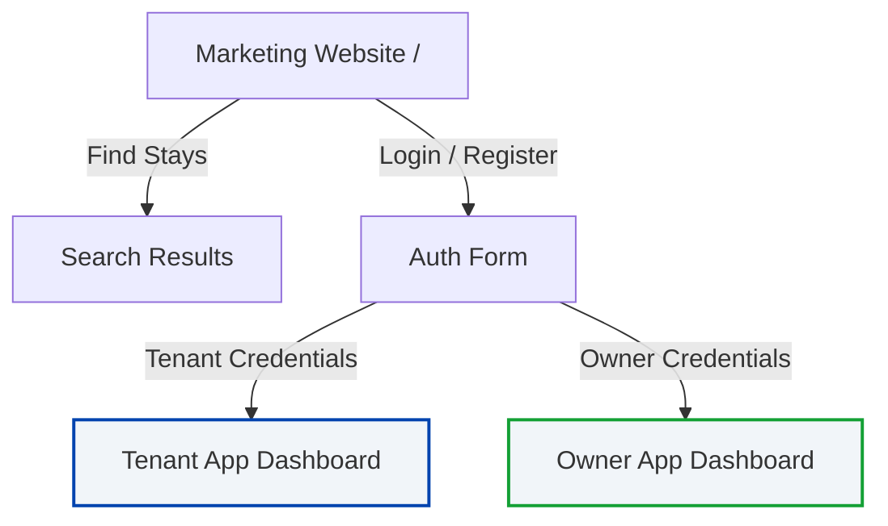

# HomiePG Marketing Website - Routing & Navigation Architecture

This document registers the active routes, state views, and external monorepo application endpoints mapping for the HomiePG platform.

---

## 1. Active Public Router Routes (Next.js App Router)

The public marketing website contains the following static routing entry points managed by Next.js:

| Route Path | Description | Filesystem File | Page Content |
|---|---|---|---|
| `/` | Marketing Homepage | `src/app/page.tsx` | Main marketing page funnel (MKT-001) |
| `/robots.txt` | Crawler Directives | `src/app/robots.ts` | Allows all user agents to crawl `/` |
| `/sitemap.xml` | Indexing Sitemap | `src/app/sitemap.ts` | Indexes the home route `/` |
| `/manifest.webmanifest` | Web Manifest Config | `src/app/manifest.ts` | Standalone app credentials and tokens |

---

## 2. In-App Section Anchors

The homepage uses scroll-to-view navigation anchors to keep users inside the discovery loop:

* `#search-section`: Main search parameters
* `#properties-grid`: Active PG listings
* `#cities-section`: Popular metropolitan centers
* `#owner-section`: Owners dashboard registration and landing CTA
* `#blog-section`: PG guides and relocation blogs

---

## 3. Public View States (`App.tsx` Controller)

For auth-flows and overlays, local state management controls the primary layout wrapper:

* `home`: Standard view showing all 15 marketing sections.
* `auth`: Simplified modal card presenting login/registration options.
* `auth-success`: A post-login screen explaining that dashboard operations reside in separate apps, providing placeholder redirection triggers.

---

## 4. Cross-Application Dashboard Registry (Monorepo Redirect Mapping)

To decouple dashboard business logic from the public marketing pages, all customer portals are managed in their respective workspace apps:

* **Tenant Dashboard App (`apps/tenant-app`):**
  * Target Environment Port: `3002` (Planned)
  * Responsibilities: Booking journey, billing history, payment logging, and bed allocation profiles.
* **Owner Dashboard App (`apps/owner-app`):**
  * Target Environment Port: `3003` (Planned)
  * Responsibilities: Property listings configuration, billing log setup, room/bed assignment lists.
* **Admin Dashboard Website (`apps/admin-website`):**
  * Target Environment Port: `3001` (Active)
  * Responsibilities: Platform control panel, registration verifications, and audit logging.
